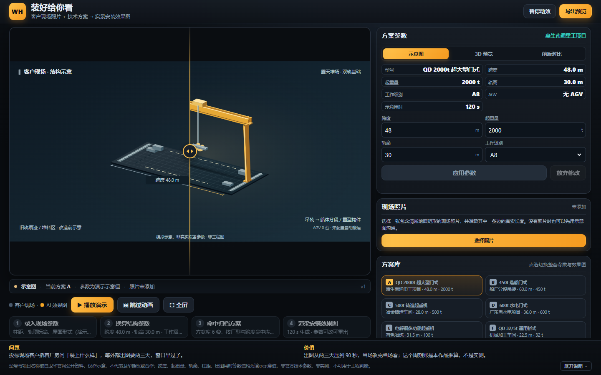
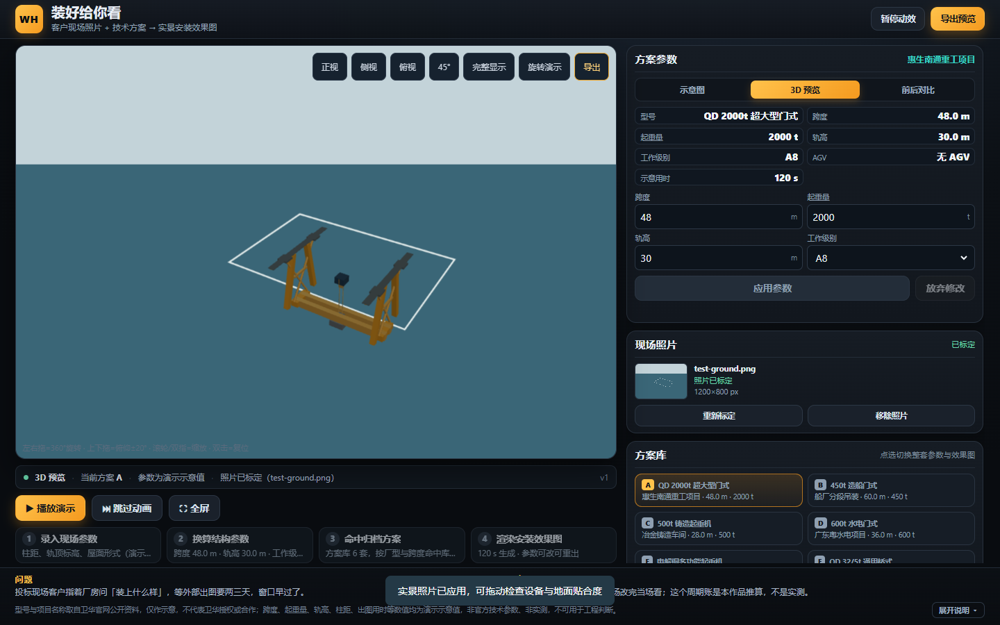
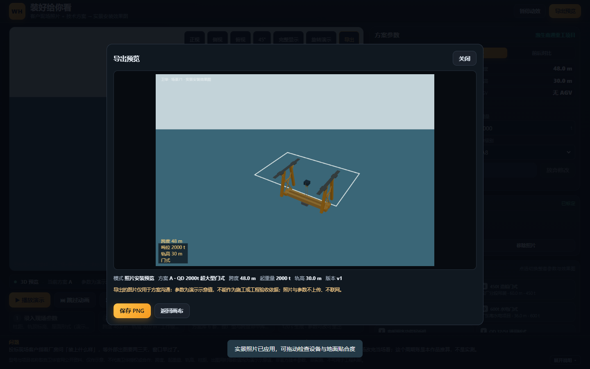
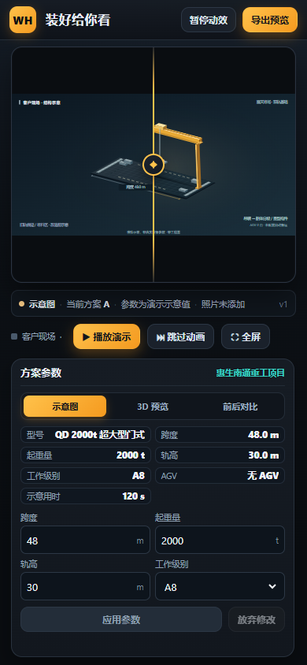

<p align="center">
  
</p>

<h1 align="center">装好给你看</h1>

<p align="center">
  <code>单文件</code> · <code>离线可用</code> · <code>零外部依赖</code> · <code>WebGL 可选</code> · <code>断网可演示</code>
</p>

<p align="center">
  客户给一张现场照片和一组技术参数，把起重设备按真实米制尺度「装」进这张照片里；<br>
  可 360° 拖动查看、可当场改参数重出、可导出 PNG 交给客户。
</p>

---

## 目录

| 章节 | 内容 |
|---|---|
| [这是什么](#这是什么) | 一句话定位与交付形态 |
| [能做什么](#能做什么) | 五项主操作与四态视图 |
| [界面](#界面) | 主界面、照片标定、导出预览 |
| [快速开始](#快速开始) | 克隆、构建、验收命令 |
| [目录结构](#目录结构) | 每个文件负责什么 |
| [架构与关键决策](#架构与关键决策) | 为什么这样拆、为什么不用外部模型 |
| [质量与验收](#质量与验收) | 两道门禁与回归脚本 |
| [能力边界](#能力边界) | 现在能做 / 现在不做 |
| [合规声明](#合规声明) | 对外表述请以此为准 |
| [文档索引](#文档索引) | 背景包、契约、验收、实施记录 |
| [故障排查](#故障排查) | 常见现象与处理 |
| [版本与时效](#版本与时效) | 本页绑定哪个提交、覆盖了什么、没覆盖什么 |

---

## 这是什么

一个**单文件 HTML 原型**，用于售前把起重方案画给客户看：把 3D 起重设备按真实米制尺度合成进客户现场照片，让客户在签单前就看到「装上去是什么样」。

它解决的是一个很具体的痛点：**客户问「我这场地装不装得下」，原来要等售前出图，短则半天长则两天**。现在改参数当场重出。

三个设计前提，决定了后面所有技术选择：

1. **现场只开放办公网**，未报备的网站连不上 → 零网络请求、零 CDN、零外部字体与图片。
2. **交付形态必须是「拷过去双击就能跑」** → 全部内联成单个 HTML，不需要服务器。
3. **参数是示意值，不是工程值** → 所有输出都带合规声明，不做结构验算。

---

## 能做什么

| # | 操作 | 结果 |
|---|---|---|
| 1 | **选方案** | 内置 6 组方案（5 类卫华公开产品线 + 1 组通用对照）；跨度、起重量、轨高、工作级别、AGV 可调 |
| 2 | **改参数** | 表单只改草稿，点「应用参数」才生效；实时列出差异（如「跨度 48.0 m → 60.0 m」），超范围就地报错 |
| 3 | **传照片** | 点「选择图片」→ 在地面点 4 个角点 → 填一条已知边长 → 模型按真实米制落位。标定时可滚轮缩放、拖动平移、放大镜精修，点选位置会换算回原图像素 |
| 4 | **看效果** | 拖动转设备（背景不动）、俯仰、缩放、双击复位；正视 / 侧视 / 俯视 / 45° 预设与旋转演示；照片模式下设备与照片同倍率缩放，米制尺度关系不变 |
| 5 | **交付** | 「导出预览」出图，文件名自动带模式、方案与日期，并叠统一水印 |

**四态视图**（右上角切换，全局唯一状态）：

| 模式 | 看什么 | 前提 |
|---|---|---|
| **示意图** | 2D 等轴测 + 对比滑块，讲「改造前 / 改造后」 | 无 |
| **3D 预览** | three.js 实景合成，可拖动查看 | 无（未标定照片时用示意地面） |
| **方案对比** | 两套方案并排，标注跨度与吨位差异 | 无 |
| **前后对比** | 现场照片与安装预览叠合对照 | **必须先标定照片**；未标定时按钮只给提示，不假装能做 |

降级路径：WebGL 不可用自动回退 2D；照片标定失败回退示意地面；2D 单文件版不含 3D 与标定模块，按钮置灰并说明原因。**任何一条降级都不白屏。**

---

## 界面

| 主界面（2D 示意图 + 参数草稿） | 照片标定后的 3D 预览 |
|---|---|
|  |  |

| 导出预览 | 移动端 |
|---|---|
|  |  |

> 截图中的照片为合成测试图（`docs/screenshots/test-ground.png`），不含真实客户信息。
> 截图取自本轮 UI 施工期间，之后界面又增加了「方案对比」视图与照片缩放，按钮排列可能略有差异。

---

## 快速开始

> **只想看效果的话，不用做任何事**：直接打开在线链接，或双击别人给你的 `作品71-3d.html` 即可。
> 下面的命令只在需要自己重新生成产物、或做二次开发时才执行；**维持现状**（不构建、直接用现成产物）也是合法选项。

```bash
git clone https://github.com/kumu314/weihua-71.git
cd weihua-71

node scene71-3d/build.js            # 主程序（3D 实景版）
node build.js                       # 2D 基座（不含 3D 与标定，体积小一半）
node scripts/verify.js --offline    # 静态验收：零外链 / 模块内联 / 体积预算
```

两个 `dist/` 都被 `.gitignore` 忽略，**clone 后必须先 build 一次**。

| 产物 | 用途 | 实测体积 |
|---|---|---|
| `scene71-3d/dist/作品71-3d.html` | **提交/演示用主程序** | 901,665 字节（881 KB） |
| `dist/作品71.html` | 2D 基座，无 3D 与标定 | 134,649 字节（132 KB） |

3D 构建器自带自检：缺模块、外部 URL、体积超 900 KB 都直接非零退出。CI 用 `--strict`，本地调试可不带（缺模块时降级成方块而不报错，便于并行开发）。

**提交作品时只交 `scene71-3d/dist/作品71-3d.html` 这一个文件**：双击即开，不需要服务器、不需要联网。

---

## 目录结构

```
weihua-71/
├─ assets/scene71-banner.svg       本页头图
│
├─ src/                            2D 基座（三条模块按契约顺序内联）
│  ├─ data.js                     六组方案数据、validateConfig 校验、合规声明
│  ├─ render.js                   等轴测 SVG 渲染 + 示意净距标注
│  └─ ui.js                       交互外壳：四态视图、参数草稿、照片面板、导出预览
│
├─ scene71-3d/
│  ├─ src/calib.js                四点配准：单应性、相机姿态、米制尺度
│  ├─ src/model.js                四形态程序化建模：桥式 / 门式 / 铸造 / 门座
│  ├─ src/view3d.js               three.js 场景壳：包围盒取景、照片背景、导出
│  ├─ src/calib-ui.js             照片上传与四点标定界面
│  ├─ src/glue.js                 2D/3D 接线：事件总线、3D 工具条、降级路径
│  ├─ vendor/three.min.js         three.js r160 UMD（构建时内联，运行时零请求）
│  ├─ template3d.html / build.js  3D 单文件构建（含自检）
│  ├─ demo_B.html / demo_C.html   开发自测页：四形态并排、相机与标定调试
│  └─ dist/作品71-3d.html         主程序产物（构建生成，不入库）
│
├─ build.js / template.html       2D 单文件构建
├─ dist/作品71.html               2D 产物（构建生成，不入库）
│
├─ scripts/verify.js              验收执行器：五项静态检查 + CDP 浏览器断言
├─ tests/ui-verify/t1~t4.cjs      交互回归：状态机、参数、照片、动效（需 Edge + playwright）
│
├─ docs/
│  ├─ 验收.md                     验收清单与现场试跑步骤
│  ├─ 演示话术口径.md             路演口径：三段必念稿、数字出处分级、备答
│  ├─ UI优化实施记录.md           本轮 UI 改动、改动文件与验收记录
│  └─ screenshots/                界面截图
│
├─ .github/workflows/check.yml    CI：2D 合成 + 3D 严格合成 + 负向自检
├─ .gitattributes                 统一 LF，避免跨平台换行抖动
├─ BRIEF.md                       场景原文、硬约束、功能清单（开工期背景包）
└─ CONTRACT.md                    三个模块的接口契约与文件边界
```

`scene71-3d/build.js` 从 `../src` 取 2D 基座（data / render / ui），与 `scene71-3d/src/` 下的 3D 模块、three.js 一起内联进 `template3d.html`，合成单文件。

---

## 架构与关键决策

| 决策 | 为什么 |
|---|---|
| **两套产物，共用 2D 基座** | 2D 是退化保障（无 WebGL 也能演示），3D 是主体验。共用 `data/render/ui` 保证两边的方案数据、参数口径、合规声明只有一份源。 |
| **程序化建模，不用 GLB/OBJ** | 外部模型文件动辄几十 MB，且无法随参数变形。用 Box/Cylinder 按跨度、吨位、轨高拼出四种机型，改参数立刻重建，且单台只有几百到几千三角面。 |
| **四形态是四套真实几何** | 桥式无落地腿（牛腿柱 + 托架）、门式 A 型斜柱 + X 格构撑 + 地面轨道、铸造梁底通长隔热罩 + 司机室、门座机门架 + 转台 + 四连杆臂架。轮廓一眼可辨，不是同一个方块换贴图。 |
| **产品自转，不是相机环绕** | 背景是一张静态照片，转相机会让照片跟着变形穿帮。所以拖动改的是模型自身的旋转，照片不动——单张照片就能 360° 看全设备。 |
| **四点地面配准** | 归一化 DLT 求单应性 → 分解焦距与主点 → 恢复相机位置、朝向、fov → 建立地面平面与像素/米比例。模型按米制落位，转一圈坐标不漂移。 |
| **包围盒反算相机距离** | 按跨度/轨高估距离，在门座机臂架伸出 30 多米、门式支腿张开时必然裁边。改成把模型包围盒 8 个角点投到相机三轴，取能装下所有角点的最小距离。 |
| **示意净距，不做碰撞** | 用「跨度 − 柱列占位 − 设备占位」给出充足/临界/不足三态，明确标「示意」，不冒充碰撞检查或有限元校核。 |
| **零依赖单文件** | three.js 与全部模块内联，运行时不发任何网络请求。代价是体积（见「能力边界」里的体积预算）。 |

---

## 质量与验收

两道门禁，一个执行器：

| 层 | 怎么跑 | 查什么 |
|---|---|---|
| **静态** | `node scripts/verify.js --offline` | 产物存在、零外部引用、无 `<script src>`、三模块已内联、体积预算 |
| **浏览器** | `node scripts/verify.js`（先起 Chrome CDP） | 真实渲染、`Runtime.exceptionThrown`、分辨率几何、交互断言 |
| **交互回归** | `node tests/ui-verify/t1-state.cjs` 等 | 状态机、参数草稿、照片标定、动效暂停（需 Edge + playwright） |

CI（`.github/workflows/check.yml`）两个 job：

- `build`：2D 合成 + 静态验收。
- `build-3d`：`--strict` 合成、断言两个模块「已接线」，并跑一条**负向自检**——临时移走 `model.js`，`--strict` 必须失败，随后恢复。**门禁自己证明自己有效**，不是只写了检查。

---

## 能力边界

| 现在能做 | 现在不做 |
|---|---|
| 六组预设方案 + 任意参数组合（跨度、起重量、轨高、工作级别、AGV） | **不解析技术方案文档**（PDF / Word / 图纸）；参数由人录入 |
| 四种机型按参数程序化生成，改参数即时重建 | 非标结构（双小车、专用吊具、异形厂房）超出这四类参数化示意体 |
| 一张现场照片 + 四点标定，模型按真实米数落位 | 不做自动灭点识别，四点需人工点选 |
| 360° 转设备、俯仰、缩放、视角预设、导出 PNG | 不做照片级光影融合，不是工程渲染图 |
| 示意净距三态（充足 / 临界 / 不足） | 不做碰撞检查、结构验算、有限元校核；工作级别只记录，不驱动造型 |
| 3D 产物体积 881 KB，距 900 KB 硬上限余约 19 KB | 不能再往 3D 产物加模块，否则构建直接失败 |

> **关于体积**：3D 产物已用掉 900 KB 预算的绝大部分（`three.min.js` 一项就占 654 KB）。后续任何 3D 增量都必须先处理体积——拆包、裁剪 three.js、或把自测页从产物里剥离。

---

## 合规声明

> 型号与项目名称取自卫华官网公开资料，**仅作示意，不代表卫华授权或合作**。
>
> 跨度、起重量、轨高、柱距、出图用时等数值均为演示示意值，**非官方技术参数、非实测，不可用于工程判断**。
>
> 效果为示意级实景合成，不是工程图、不是施工依据。

这四句话同时出现在页面底部与导出图的文件说明里，不依赖口播。

---

## 文档索引

| 想看什么 | 去哪 |
|---|---|
| 场景原文、硬约束、功能清单、6 分钟节奏 | [`BRIEF.md`](BRIEF.md) |
| 三个模块的接口契约、加载顺序、文件边界 | [`CONTRACT.md`](CONTRACT.md) |
| 验收清单与现场试跑步骤 | [`docs/验收.md`](docs/验收.md) |
| 路演口径：三段必念稿、数字出处分级、两版备答 | [`docs/演示话术口径.md`](docs/演示话术口径.md) |
| 本轮 UI 改了什么、改了哪些文件、验收记录 | [`docs/UI优化实施记录.md`](docs/UI优化实施记录.md) |

---

## 故障排查

| 现象 | 原因 | 处理 |
|---|---|---|
| 双击打开是空白 | 直接开了 `src/*.js` 或模板，不是产物 | 先 `node scene71-3d/build.js`，打开 `scene71-3d/dist/作品71-3d.html` |
| 「3D 预览」按钮是灰的 | 当前是 2D 单文件版，不含 3D 模块 | 用 `node scene71-3d/build.js` 构建主程序 |
| 3D 区域空白但页面正常 | 浏览器不支持 WebGL | 换 Chrome / Edge；页面会自动回退到 2D，不会白屏 |
| 照片标定后设备浮在半空 | 四个角点没点在同一地面上，或边长填错 | 重选角点：找地面、找大块、找斜的，按顺时针点 |
| `node scene71-3d/build.js` 报 `体积超 900KB` | 3D 产物撞上限 | 见「能力边界」里的体积说明，先做减法 |
| `git diff` 显示整个文件被重写 | 跨平台换行差异 | 仓库已加 `.gitattributes` 统一 LF，重新 clone 或 `git add --renormalize .` |
| 照片放大后点的角点位置偏移 | 缩放平移没换算回原图坐标（旧版问题） | 当前标定界面已把点选位置换算回原图像素；若仍偏，重新打开标定弹层再点 |

---

## 版本与时效

- **本页描述 `main` 上已合入的能力**，绑定提交 `d82a792`（2026-11-11）。在途 PR 的能力不写入本页，避免线上与文档不一致。
- **只浏览不需要执行任何命令**：上面的构建与验收命令只在需要重新生成产物、或做二次开发时才用。
- **已验证**：Windows 上两条构建、静态验收、headless Chrome 的 2D 与 3D 真实渲染、四项交互回归脚本。
- **未覆盖**：macOS 与 Linux 只做了构建验证，没做浏览器实测；移动端只验证了布局与触控基本可用，没做完整交互回归；iOS Safari 未测。
- **体积与余量**：3D 产物 901,665 字节，上限 921,600 字节，余 19,935 字节。此数会随每次构建变化，以 `node scene71-3d/build.js` 的输出为准。
- **截图可能滞后于界面**：`docs/screenshots/` 里的四张图取自本轮 UI 施工期间，之后又增加了「方案对比」视图与照片缩放，按钮排列与实物可能略有差异。以实际运行为准。
- **不维护本页的代价**：读者会按旧描述踩空。上一版写「右上 3D 实景」，当前界面已是四态「示意图 / 3D 预览 / 方案对比 / 前后对比」；上一版写「主程序 804 KB」，实测已是 881 KB。**过期的文档比没有文档更费时间**，所以每次改动界面或体积口径时，这一页要跟着改。

---

<p align="center">
  <sub>卫华黑客松 · 场景 71 · 内容创作 · 归属 活动方</sub>
</p>
