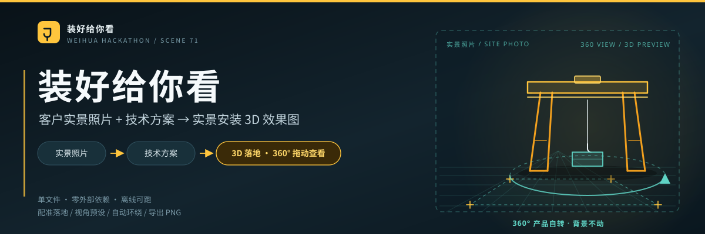

<p align="center">
  
</p>

# 装好给你看 · 场景 71

> 客户给一张现场实景照片和一份技术方案，工具把起重设备按方案「装」进这张照片里，生成可 360° 拖动查看的实景安装效果，并导出 PNG 交给客户。

| | |
|---|---|
| **在线体验 · 作品链接** | https://weihua-scene71-3d.app.workbuddy.host/?sharecode=7IYW27SUQC |
| **主程序** | `scene71-3d/dist/作品71-3d.html` — 单文件 804 KB、零外部依赖、离线双击即跑 |
| **源码仓库** | https://github.com/kumu314/weihua-71 |

## 它能做什么

| # | 操作 | 结果 |
|---|---|---|
| 1 | **选方案** | 内置 6 组方案（5 类卫华公开产品线 + 1 组通用对照）；跨度、起重量、轨高、柱距、AGV 可调，改完当场重出 |
| 2 | **传照片** | 点「实景照片」→ 选图 → 在地面点 4 个角点 → 填一条已知边长 |
| 3 | **落地** | 由四点透视求单应性与相机姿态（fov / 位置 / 地面平面 / 像素-米比例），3D 模型按真实米制尺度放进照片 |
| 4 | **看效果** | 左右拖 360° 转设备（背景不动）、上下拖俯仰 ±20°、滚轮或双指缩放、双击复位；另有正视 / 侧视 / 俯视 / 45° 预设与自动环绕 |
| 5 | **交付** | 「导出 PNG」出效果图 |

**双视图**：右上「3D 实景」在 2D 等轴测示意图与 3D 实景间切换。WebGL 不可用自动回退 2D；配准失败回退示意地面，不会白屏。

## 快速开始

```bash
git clone https://github.com/kumu314/weihua-71.git
cd weihua-71

node scene71-3d/build.js           # 主程序 → scene71-3d/dist/作品71-3d.html
node build.js                      # 2D 基座 → dist/作品71.html（可选）
node scripts/verify.js --offline   # 静态验收：零外链 / 模块内联 / 体积
```

两个 `dist/` 均被 `.gitignore` 忽略，clone 后需自行 build。提交「程序」时附上 `scene71-3d/dist/作品71-3d.html` 即可：单文件、不需要服务器、不需要联网。3D 构建器自带自检（缺文件、外部 URL、体积超 900 KB 直接报错）。

## 目录结构

```
weihua-71/
├─ assets/scene71-banner.svg       本页头图
├─ src/                            2D 基座
│  ├─ data.js                     六组方案数据、参数校验、合规声明
│  ├─ render.js                   等轴测 SVG 渲染
│  └─ ui.js                       四步流程、参数交互、占位符填充
├─ scene71-3d/
│  ├─ src/calib.js                A · 四点配准、相机姿态、米制尺度
│  ├─ src/model.js                B · 桥式/门式/铸造/门座四形态建模
│  ├─ src/view3d.js               C · 场景壳、照片背景、产品自转、视角预设、导出
│  ├─ src/calib-ui.js             照片上传与四点标定界面
│  ├─ src/glue.js                 2D/3D 接线、3D 工具栏、降级路径
│  ├─ vendor/three.min.js         three.js r160 UMD（构建时内联）
│  ├─ template3d.html / build.js  3D 单文件构建
│  └─ dist/作品71-3d.html         主程序（构建生成，不入库）
├─ build.js / template.html       2D 单文件构建
├─ dist/作品71.html               2D 产物（构建生成，不入库）
├─ scripts/verify.js              验收执行器：静态检查 + CDP 浏览器断言
├─ docs/                          验收清单、演示话术口径
├─ .github/workflows/check.yml    CI：2D 合成 + 静态验收
└─ BRIEF.md / CONTRACT.md         开工期背景与接口契约（存档）
```

`scene71-3d/build.js` 从 `../src` 取 2D 基座（data / render / ui），与 `scene71-3d/src/` 下的 3D 模块、three.js 一起内联进 `template3d.html`。

## 技术要点

- **四点地面配准**：归一化 DLT 求单应性 H → 分解焦距与主点 → 恢复相机位置、朝向、fov → 建立地面平面和像素/米比例，模型按米制落位，转一圈坐标不漂移。
- **程序化建模**：不依赖外部 GLB/OBJ，用 Box / Cylinder 拼四种机型，由跨度、起重量、轨高、AGV 参数驱动体量。
- **产品自转，不是相机环绕**：背景照片固定，拖动改的是 `modelGroup.rotation.y`，因此单张照片就能 360° 看全设备。
- **零依赖单文件**：three.js r160 UMD 与全部模块内联，运行时不发任何网络请求；不支持 WebGL 时自动降级。

## 边界（对外表述请以此为准）

- 型号与项目名称取自卫华官网公开资料，**仅作示意，不代表卫华授权或合作**；跨度、起重量、轨高、柱距、出图用时等数值均为演示示意值，非官方技术参数、非实测，**不可用于工程判断**。
- 效果是示意级实景合成，未做照片级光影融合，不是工程图或渲染出图。
- 当前按结构化参数录入方案，不解析技术文档正文；不做自动灭点识别、碰撞检查与有限元校核。
- 3D 视图需要浏览器支持 WebGL；照片请通过页面内「实景照片」上传。
